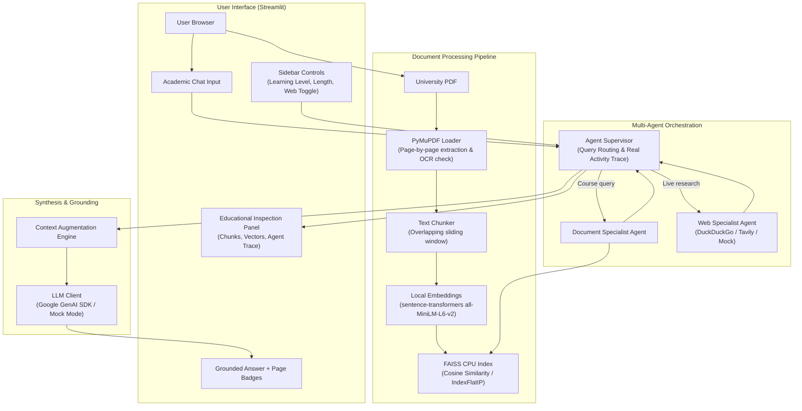

<div align="center">

# 🎓 Athena AI Lite
### A Transparent, Educational Multi-Agent RAG Assistant Built from Scratch

[](https://www.python.org/)
[](https://streamlit.io/)
[](https://github.com/facebookresearch/faiss)
[](https://pymupdf.readthedocs.io/)
[](LICENSE)
[](tests/)

<p align="center">
  <b>Learn how modern Retrieval-Augmented Generation (RAG) and Multi-Agent Orchestration work under the hood.</b><br>
  <i>No LangChain. No LangGraph. No black-box frameworks. Just pure, clean Python classes and explicit data pipelines.</i>
</p>

</div>

---

## 🌟 Why Athena AI Lite?

Many beginners learning AI get overwhelmed by complex frameworks like LangChain, LlamaIndex, or LangGraph that hide vector math, prompt templates, and agent state machines behind multiple layers of abstraction.

**Athena AI Lite** teaches you the actual mechanics:
- **How text becomes numbers:** Understand vector embeddings and $L_2$-normalization.
- **How similarity search works:** See FAISS compute exact **Cosine Similarity** via `IndexFlatIP`.
- **How RAG prevents hallucination:** Ground answers directly in retrieved document chunks.
- **Why citations matter:** Maintain non-hallucinated page citations in application code.
- **How agents cooperate:** Observe a Supervisor coordinate Document and Web Agents with a live execution trace.
- **Inspect everything:** Use the collapsible **"How the AI Works"** panel to see every intermediate score, chunk, and routing decision.

---

## 🏗️ Architecture Overview



---

## ✨ Key Features

| Feature | Description | File |
| :--- | :--- | :--- |
| 📄 **Page-Aware PDF Loader** | Extracts text page-by-page, preserves exact page numbers, and detects scanned/raster PDFs without selectable text. | [`core/pdf_loader.py`](core/pdf_loader.py) |
| 🧩 **Text Chunking** | Configurable chunk size and overlap with intelligent word-boundary snapping. | [`core/chunker.py`](core/chunker.py) |
| 🧠 **Dense Embeddings** | Generates 384-dimensional normalized vectors with local `sentence-transformers`. | [`core/embeddings.py`](core/embeddings.py) |
| ⚡ **FAISS Vector Store** | Hardware-accelerated nearest-neighbor search with strict ID-to-metadata mapping. | [`core/vector_store.py`](core/vector_store.py) |
| 🎯 **Grounded RAG Pipeline** | Strict evidence-constrained prompts; reports missing evidence honestly instead of guessing. | [`core/rag_pipeline.py`](core/rag_pipeline.py) |
| 🌐 **Live Web Search** | Optional real-time internet search via DuckDuckGo (free, zero-config) or Tavily. | [`core/web_search.py`](core/web_search.py) |
| 🤖 **Specialist Multi-Agents** | Document Agent + Web Agent coordinated by a Supervisor with a genuine activity trace. | [`agents/`](agents/) |
| 🎚️ **Adaptive Personalization** | Dynamically adapts explanation depth (`Beginner`, `Intermediate`, `Advanced`) and answer length. | [`config.py`](config.py) |
| 🔍 **Under-the-Hood Panel** | Live inspection of raw chunks, cosine scores, vector dimensions, and routing logic. | [`app.py`](app.py) |
| 🧪 **Zero-API Test Suite** | 25 automated tests run deterministically offline in under 4 seconds. | [`tests/`](tests/) |

---

## 🚀 Quickstart Guide

### 1. Clone the Repository
```bash
git clone https://github.com/your-username/athena-ai-lite.git
cd athena-ai-lite
```

### 2. Create and Activate Virtual Environment
```bash
# On Windows (PowerShell):
python -m venv .venv
.\.venv\Scripts\activate

# On macOS/Linux:
python3 -m venv .venv
source .venv/bin/activate
```

### 3. Install Dependencies
```bash
pip install -r requirements.txt
```

### 4. (Optional) Configure Environment Variables
Copy `.env.example` to `.env`:
```bash
cp .env.example .env
```
Edit `.env` to add your keys:
```ini
# Obtain from https://aistudio.google.com/
# (If left empty, Athena AI Lite runs in clearly labeled Mock Mode for safe offline learning)
GEMINI_API_KEY=your_gemini_api_key_here
GEMINI_MODEL=gemini-2.5-flash

# Options: "duckduckgo" (free, no key needed), "tavily", or "mock"
WEB_SEARCH_PROVIDER=duckduckgo
TAVILY_API_KEY=
```

### 5. Launch the Application
```bash
streamlit run app.py
```
Open **`http://localhost:8501`** in your browser!

> 💡 **Try it immediately:** A sample university syllabus is pre-generated at [`data/uploads/sample_syllabus.pdf`](data/uploads/sample_syllabus.pdf). Upload it directly into the web UI!

---

## 🧪 Running Automated Tests

Run the full pytest suite:
```bash
pytest -v
```
All 25 tests pass completely offline without requiring paid API keys or network access:
```text
tests/test_chunker.py::test_chunk_text_empty PASSED                      [  4%]
tests/test_chunker.py::test_chunk_text_short_document PASSED             [  8%]
tests/test_chunker.py::test_chunk_text_overlap PASSED                    [ 12%]
...
tests/test_supervisor.py::test_supervisor_multi_agent_execution PASSED   [ 84%]
tests/test_web_search.py::test_mock_web_search PASSED                    [ 92%]
tests/test_web_search.py::test_tavily_missing_key_fallback PASSED        [100%]
============================= 25 passed in 3.85s ==============================
```

---

## 📂 Project Structure

```text
athena-ai-lite/
├── app.py                      # Interactive Streamlit UI & debug inspector
├── config.py                   # Central hyperparameters, paths, and preferences
├── requirements.txt            # Minimal dependency list
├── .env.example                # Environment variables template
├── LICENSE                     # MIT License
├── README.md                   # Project documentation
│
├── core/                       # Core RAG subsystems
│   ├── pdf_loader.py           # PyMuPDF page-aware extraction
│   ├── chunker.py              # Overlapping text chunker
│   ├── embeddings.py           # Sentence-transformers embeddings & normalization
│   ├── vector_store.py         # FAISS CPU vector index & persistence validation
│   ├── retriever.py            # Semantic search coordinator
│   ├── llm_client.py           # Google GenAI SDK client with labeled Mock Mode
│   ├── web_search.py           # DuckDuckGo, Tavily, and Mock web search adapters
│   └── rag_pipeline.py         # Explicit RAG pipeline & citation builder
│
├── agents/                     # Multi-agent coordination layer
│   ├── document_agent.py       # Specialist for university PDF retrieval
│   ├── web_agent.py            # Specialist for external web discovery
│   └── supervisor.py           # Coordinator: routing, tool dispatch, activity tracing
│
├── data/
│   ├── uploads/                # Directory for uploaded documents (sample syllabus included)
│   ├── indexes/                # Directory for persisted FAISS indexes
│   └── preferences.json        # Persisted user customization settings
│
├── tests/                      # Comprehensive pytest test suite
│   ├── test_pdf_loader.py
│   ├── test_chunker.py
│   ├── test_retriever.py
│   ├── test_rag_pipeline.py
│   ├── test_web_search.py
│   └── test_supervisor.py
│
└── docs/                       # In-depth educational documentation
    ├── LEARNING_GUIDE.md       # Conceptual guide linking theory to Python functions
    └── ARCHITECTURE.md         # Technical architecture, sequences, and data contracts
```

---

## 📚 Educational Documentation

For a deeper dive into the theory and exact code mechanics:
- 📖 **[Learning Guide](docs/LEARNING_GUIDE.md):** Beginner-friendly explanations of LLMs, vector spaces, cosine similarity, FAISS indexing, RAG failure modes, agent coordination, and evaluation.
- 📐 **[Architecture Specification](docs/ARCHITECTURE.md):** Detailed system architecture diagrams, sequence diagrams, and typed data contracts.

---

## 🤝 Contributing

Contributions, issues, and feature requests are welcome! Feel free to check the [issues page](https://github.com/your-username/athena-ai-lite/issues).

---

## 📄 License

This project is licensed under the MIT License — see the [LICENSE](LICENSE) file for details.
