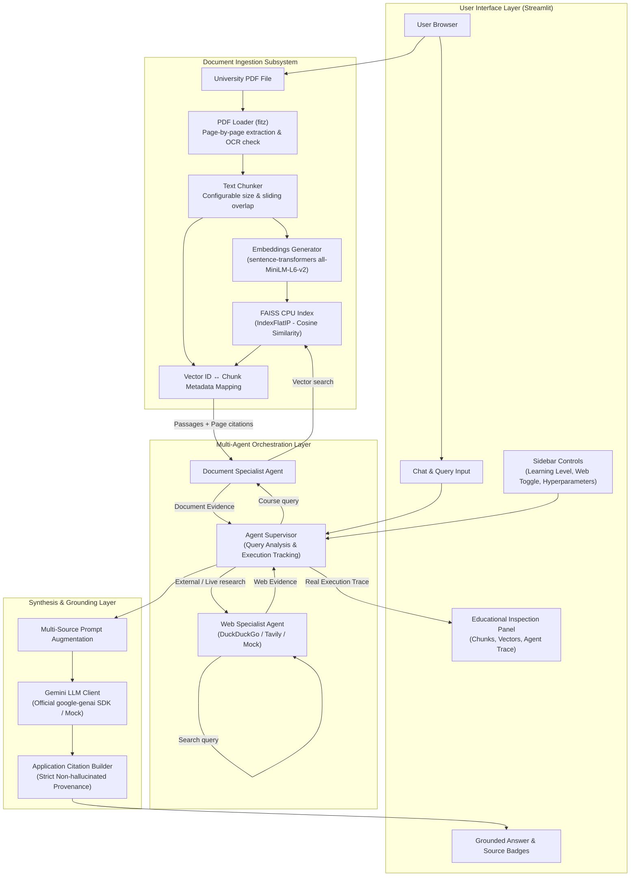
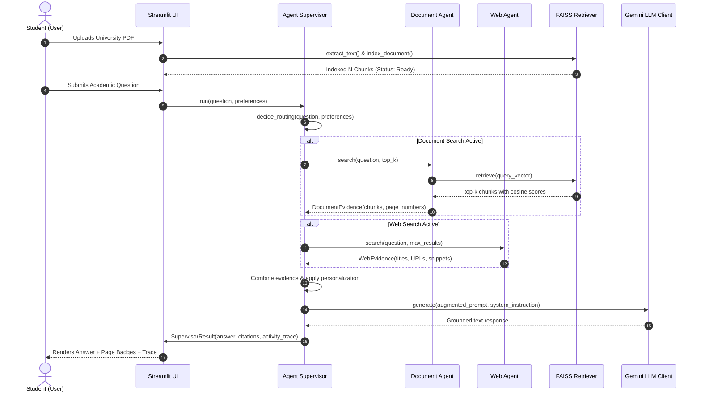

# Athena AI Lite — Architecture Specification

This document details the architectural layout, data contracts, and component interaction flows of **Athena AI Lite**.

---

## 1. System Architecture Diagram



---

## 2. Component Directory Layout

```
athena-ai-lite/
├── app.py                     # Streamlit frontend & interactive debug inspector
├── config.py                  # Settings, paths, environment loader, user preferences
├── requirements.txt           # Minimal, explicit dependencies
├── .env.example               # Configuration template for API keys & model names
├── README.md                  # Quickstart, setup instructions, and overview
│
├── core/
│   ├── pdf_loader.py          # PyMuPDF page-aware PDF text extraction & OCR detection
│   ├── chunker.py             # Overlapping text chunker with word-boundary awareness
│   ├── embeddings.py          # sentence-transformers local model & L2 normalization
│   ├── vector_store.py        # FAISS CPU IndexFlatIP vector store & persistence validation
│   ├── retriever.py           # Ties embeddings and FAISS together into semantic search
│   ├── llm_client.py          # Official Google GenAI SDK adapter with labeled Mock Mode
│   ├── web_search.py          # DuckDuckGo, Tavily, and Mock web search adapters
│   └── rag_pipeline.py        # Explicit step-by-step RAG sequence & citation builder
│
├── agents/
│   ├── document_agent.py      # Specialist for active university PDF retrieval
│   ├── web_agent.py           # Specialist for external web discovery
│   └── supervisor.py          # Coordinator: routing, tool dispatch, activity tracing
│
├── data/
│   ├── uploads/               # Temporary storage for uploaded university documents
│   ├── indexes/               # Persisted FAISS index files and metadata mappings
│   └── preferences.json       # Persisted user customization settings
│
├── tests/
│   ├── test_pdf_loader.py     # Extraction tests on synthetic in-memory PDFs
│   ├── test_chunker.py        # Boundary, overlap, empty text, and error tests
│   ├── test_retriever.py      # FAISS top-k retrieval, metadata mapping, and persistence
│   └── test_supervisor.py     # Agent routing, provenance, and activity trace verification
│
└── docs/
    ├── LEARNING_GUIDE.md      # Beginner-friendly conceptual and code walkthrough
    └── ARCHITECTURE.md        # Technical architecture, sequence, and data flow
```

---

## 3. Data Flow and Execution Sequence



---

## 4. Key Data Contracts

### TextChunk (`core/chunker.py`)
```python
@dataclass
class TextChunk:
    chunk_id: str          # e.g. "chunk_003_p2"
    doc_name: str          # e.g. "cs101_syllabus.pdf"
    page_number: int       # 1-indexed source page
    text: str              # Slice text
    start_char: int        # Character start offset
    end_char: int          # Character end offset
    char_count: int        # len(text)
    metadata: dict         # Extensible metadata dictionary
```

### SearchResult (`core/vector_store.py`)
```python
@dataclass
class SearchResult:
    chunk_id: str          # Retrieved chunk ID
    doc_name: str          # Source file
    page_number: int       # Page citation
    text: str              # Passage text
    score: float           # Cosine similarity score [-1.0, 1.0]
    rank: int              # Retrieval rank (1 = most relevant)
    metadata: dict         # Original chunk metadata
```

### Citation (`core/rag_pipeline.py`)
```python
@dataclass
class Citation:
    citation_id: str       # Chunk identifier
    doc_name: str          # Document name
    page_number: int       # Source page number
    score: float           # Cosine similarity
    text_snippet: str      # First 140 characters of evidence
```

### ActivityStep (`agents/supervisor.py`)
```python
@dataclass
class ActivityStep:
    step_name: str         # e.g. "Searching uploaded document"
    status: str            # "completed", "skipped", "error"
    detail: str            # Descriptive trace output
    timestamp: float       # Epoch seconds of actual execution
```
